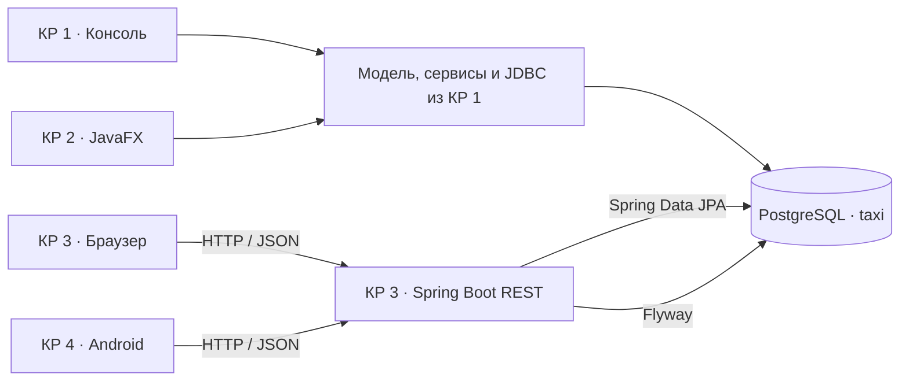
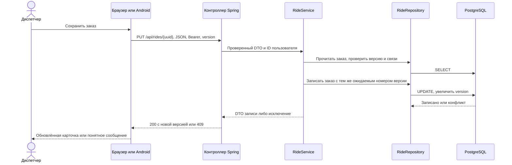

# Как устроена «Служба такси»

У команды одна предметная область и одна основная запись — заказ поездки. С каждой работой добавляется новый способ работы с теми же заказами. Для демонстрации всех четырёх работ используйте один PostgreSQL из корневого Docker Compose.

## Сущности и идентификаторы

- **Пассажир** хранится в `passengers`. У него числовой ID, имя и уникальный телефон. Ссылку на пассажира хранит `ride_orders.passenger_id`.
- **Заказ поездки** хранится в `ride_orders`. КР 1 и КР 2 используют ключ `id`, например `11`. КР 3 добавляет `public_id` для REST и `external_code` для поиска, отображения и импорта. Один и тот же заказ может выводиться как `#11` в консоли, `TX-11` в приложении и иметь UUID в адресе REST.
- **Тариф** — справочник для заказов. При отключении тариф остаётся в существующих поездках. Для нового заказа или изменения тарифа доступен активный вариант.
- **Учётная запись** — пользователь приложения с одной ролью. Пассажир продолжает описывать клиента такси.
- **Заметка**, **теги**, **refresh-сессия** и **аудит** добавлены серверными миграциями. Заметка связана с заказом и автором. Аудит хранит идентификаторы событий и запроса.

КР 1 создаёт таблицы и загружает пассажиров и заказы из SQL. КР 2 повторно использует классы сервиса, репозиториев и экспорта. КР 3 сохраняет числовые ID. При подключении к уже установленной КР 1 Flyway отмечает базовую схему как версию 1 и накатывает версию 2. На пустом PostgreSQL Flyway применяет обе миграции. При записи через прежние JDBC-клиенты PostgreSQL автоматически назначает публичный UUID, код `TX-<id>`, стандартный тариф и время изменения.

## Один заказ во всех четырёх работах

1. **Консоль.** У пассажира № 1 создайте поездку «ул. Лесная, 5 → м. Сокол», стоимость 690,50 ₽, подача 1 декабря 2026 в 09:30 МСК. Укажите время по формату консоли `2026-12-01 09:30`. Запомните выданный числовой ID.
2. **JavaFX.** Нажмите «Обновить» и найдите поездку по пассажиру или адресу. Выберите строку и измените стоимость на 710,50 ₽. `RideOrderService` открывает заказ по ID, сравнивает версию и передаёт новые поля JDBC. `UPDATE ... WHERE id = ? AND version = ?` меняет данные и увеличивает версию атомарно.
3. **Веб.** Найдите `TX-<id>`, откройте карточку и смените статус на «Подтверждён». JavaScript отправляет JSON и версию прочитанного заказа. Spring проверяет роль, DTO и допустимый переход. Hibernate записывает состояние и версию, а сервис фиксирует событие в аудите.
4. **Android.** Войдите под диспетчером, откройте заказы и обновите список жестом. Найдите тот же код и добавьте закреплённую заметку «Пассажир ждёт у первого подъезда». Клиент отправит отдельный REST-запрос. Обновите веб-карточку, чтобы увидеть текст, автора и время.
5. **Проверка конкуренции.** Откройте новую поездку в двух формах. Сохраните из первой и попробуйте из второй. Запись защищена PostgreSQL и полем версии, на REST придёт `409 CONFLICT`. Обновите карточку и повторите изменение осознанно.
6. **Архив.** Архивируйте заказ в браузере или Android. Он исчезнет из обычного списка, появится при выборе «Архив» и вернётся после восстановления. На базе после миграции консоль и JavaFX тоже скрывают архивные заказы. На схеме одной КР 1 поля `archived` ещё нет, поэтому JDBC выбирает все строки.

## От формы до ответа REST

Сервисные правила сформулированы на Java. Для стоимости используется `BigDecimal`, даты подачи записываются как местное время Москвы, время аудита и создания заметок — как UTC. PostgreSQL применяет внешние ключи и ограничения. Ограничения прав пользователей работают в Spring API. Локальные JDBC-клиенты работают под отдельной ролью PostgreSQL с доступом к данным учебной базы.

## Подготовка команды

| Участник | Основная область | Сквозной пример |
| --- | --- | --- |
| Сергеев Алексей Сергеевич | Архитектура, бизнес-правила, серверные сервисы | Создание заказа, версия, переход статуса и конфликт `409` |
| Василевская Вероника Валерьевна | Интерфейсы консоли, JavaFX, веба и Android | Форма, ввод некорректной даты, поиск, обратная связь |
| Со Артем Алексеевич | PostgreSQL, SQL, JDBC, JPA и Flyway | Один заказ через SQL, JDBC и REST, разбор внешних ключей |
| Дадаев | Выборки, тесты, отчётность, Android-сессия и обмен файлами | Пагинация, аналитика, CSV preview/apply, восстановление входа |

Фамилия Дадаев приведена в том виде, в котором она указана в таблице вариантов. Назначения в таблице — распределение выступления на защите. Каждый участник должен пройти сквозной сценарий целиком.
