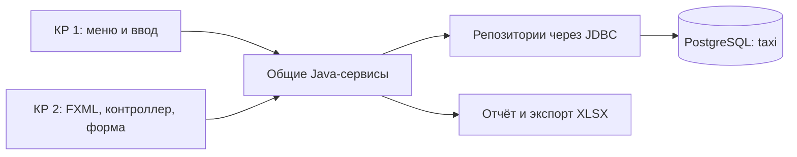
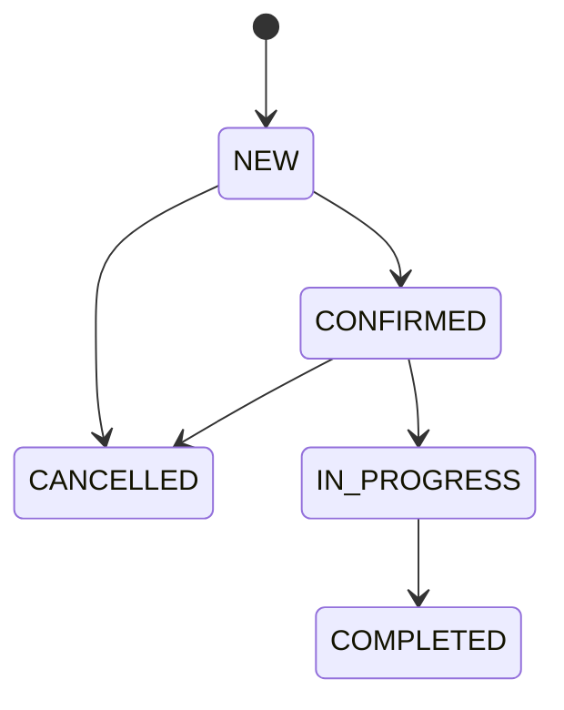

# Java с нуля на примере «Службы такси»

Практический гайд к защите КР № 1 и № 2. Вариант 34. Инструкции рассчитаны на Windows, PowerShell и настроенный VS Code.

[Запуск](#1-как-запустить-на-своём-компьютере) · [Java для разработчика на Python](#2-минимум-java-если-ты-знаешь-python) · [Карта проекта](#3-где-лежат-файлы) · [КР-1](#4-кр-1-от-пункта-меню-до-sql) · [КР-2](#5-кр-2-от-кнопки-до-sql) · [Репетиция](#7-сценарий-защиты-на-7-минут) · [Вопросы](#8-тренировка-вопросов-преподавателя)

## Что сказать в начале защиты

> Мы сделали приложение диспетчера такси. В PostgreSQL хранятся пассажиры и заказы поездок. Один пассажир может иметь несколько заказов. В первой работе диспетчер вводит команды в терминале, во второй работает в JavaFX. Оба интерфейса передают данные в общие Java-сервисы. Сервисы проверяют правила и вызывают репозитории, а репозитории выполняют SQL через JDBC. Поэтому заказ, созданный в консоли, можно открыть и изменить в JavaFX.

Запомни цепочку **интерфейс принимает → сервис проверяет → репозиторий выполняет SQL → PostgreSQL хранит**. По ней можно объяснить почти любую кнопку.



## 1. Как запустить на своём компьютере

### Один раз перед демонстрацией

1. Открой Docker Desktop. Дождись запуска движка.
2. В VS Code выбери **File → Open Folder** и открой папку проекта `Корпаративы`. В ней видны каталоги `kr-01`–`kr-04` и корневой `compose.yaml`.
3. Открой **Terminal → New Terminal**. Удобно создать два терминала через кнопку **+** в панели Terminal. В обоих оставайся в корне проекта.
4. Проверь Java и запусти PostgreSQL.

```powershell
Get-Location
java -version
mvn -v
docker compose up -d --wait postgres
docker compose ps
```

`mvn -v` должен показывать Java **21**. Контейнер `postgres` должен быть `healthy`. Строка подключения из приложений — `jdbc:postgresql://127.0.0.1:5434/taxi`. Если терминал был открыт во время настройки VS Code, закрой этот терминал и создай новый. При необходимости выполни **Developer: Reload Window** через `Ctrl+Shift+P`. Если во внешнем PowerShell по-прежнему видна Java 8 или отсутствует `mvn`, в текущем сеансе можно подставить уже настроенные пользовательские пути:

```powershell
$env:JAVA_HOME = [Environment]::GetEnvironmentVariable('JAVA_HOME', 'User')
$env:MAVEN_HOME = [Environment]::GetEnvironmentVariable('MAVEN_HOME', 'User')
$env:Path = "$env:JAVA_HOME\bin;$env:MAVEN_HOME\bin;$env:Path"
mvn -v
```

Корневой Compose запускает общую учебную базу. При первом запуске нового тома загружаются 5 пассажиров и 10 поездок из SQL. В существующем томе хранятся сделанные ранее изменения. Поэтому после репетиции количество заказов и выданные ID могут отличаться от примеров. Для первых двух работ достаточно сервиса `postgres`. Если `backend` уже работает, можно оставить его запущенным.

### КР № 1. Консоль

В первом терминале, из корня:

```powershell
.\scripts\Start-TaxiConsole.ps1
```

Появится меню «Служба такси». Напечатай `5` и Enter. На исходных данных увидишь 5 пассажиров, 10 заказов и 1850 ₽ за завершённые поездки. В подменю `0` возвращает на уровень выше, в главном меню `0` закрывает приложение. Вариант запуска через VS Code — **Ctrl+Shift+P → Tasks: Run Task → Такси: консоль**.

Скрипт настраивает UTF-8 и загружает параметры базы для этого терминала. Затем он вызывает Maven с файлом `kr-01/pom.xml`. Флаг `-q` оставляет меньше служебного вывода. Цель `compile` компилирует код, а `exec:java` запускает точку входа `ru.mirea.taxi.Main`, указанную в POM.

### КР № 2. Графическое окно

Во втором терминале, из того же корня:

```powershell
.\scripts\Use-TaxiEnvironment.ps1
mvn -q -pl kr-01 install
mvn -q -f kr-02/pom.xml javafx:run
```

Откроется окно «Служба такси — рабочее место диспетчера». Проверка успеха — таблица заказов и вкладка «Пассажиры» заполнены. На исходной базе внизу написано «Заказы 10 из 10 · Пассажиры 5». Чтобы закрыть приложение, закрой окно. Команда в терминале завершится. Вариант через VS Code — **Ctrl+Shift+P → Tasks: Run Task → Такси: JavaFX**.

КР 2 перечисляет `taxi-console` как зависимость в своём [pom.xml](../kr-02/pom.xml). Команда `mvn -pl kr-01 install` собирает JAR и кладёт его в локальный Maven-репозиторий. После изменений общего Java-кода повтори `install`, чтобы отдельный запуск КР 2 увидел новую версию. Правила Maven описаны в [документации о фазах сборки](https://maven.apache.org/guides/introduction/introduction-to-the-lifecycle.html).

### КР № 3 и № 4 — на будущее

| Работа | Как открыть локально |
| --- | --- |
| КР 3, веб | В корне выполни `.\scripts\Initialize-Local.ps1`, затем `docker compose up -d --build --wait`. Открой [http://127.0.0.1:8081/](http://127.0.0.1:8081/). Первый вход — данные из локального `.env`. [Отчёт по КР 3](../kr-03/README.md) |
| КР 4, Android | Оставь сервер КР 3 запущенным. В Android Studio открой `kr-04`, запусти Android Emulator API 35 и конфигурацию `app`. Отладочный APK обращается к серверу с адреса эмулятора `10.0.2.2:8081`. [Отчёт по КР 4](../kr-04/README.md) |

На этом компьютере уже есть эмулятор `MireaTaxiApi35`. Готовый APK можно запустить и из терминала. В первом терминале открой эмулятор:

```powershell
$sdk = "$env:LOCALAPPDATA\Android\Sdk"
& "$sdk\emulator\emulator.exe" -avd MireaTaxiApi35
```

После загрузки Android во втором терминале из корня проекта:

```powershell
$sdk = "$env:LOCALAPPDATA\Android\Sdk"
& "$sdk\platform-tools\adb.exe" devices
& "$sdk\platform-tools\adb.exe" install -r delivery/taxi-variant34-debug.apk
& "$sdk\platform-tools\adb.exe" shell am start -n 'ru.mirea.taxi.mobile/.ui.MainActivity'
```

Последние две команды рассчитаны на один подключённый эмулятор. Для входа Android использует учётную запись того же backend, что и браузер.

### Если запуск не получается

| Что видишь | Что проверить |
| --- | --- |
| Docker сообщает, что не может подключиться к daemon | Открой Docker Desktop, дождись готовности и повтори `docker compose ps` |
| Maven показывает Java 8 или пишет `release version 21 not supported` | Проверь `mvn -v` в новом терминале VS Code. Используй блок с пользовательскими путями выше |
| КР 2 сообщает, что `taxi-console:1.0.0` не найден | Выполни из корня `mvn -pl kr-01 install`, затем повтори `javafx:run` |
| JavaFX открылся с ошибкой подключения | Проверь `docker compose ps`, выполни `.\scripts\Use-TaxiEnvironment.ps1` в том же терминале перед запуском |
| Недоступна кнопка «Изменить» или «Удалить» | Выбери строку и посмотри статус. Правила описаны ниже |
| Заказ есть в консоли, но его не видно в JavaFX | Нажми «Сбросить», затем «Обновить». Фильтр может скрывать строку, а таблица перечитывает базу по кнопке |
| Экспорт не перезаписывает файл | Закрой этот файл в Excel или выбери новое имя |
| Кириллица выводится искажённо в консоли | Выйди клавишей `0` и запусти из корня `.\scripts\Start-TaxiConsole.ps1` или задачу VS Code **Такси: консоль** |

## 2. Минимум Java, если ты знаешь Python

| Знакомое из Python/FastAPI | Как читать в этом проекте |
| --- | --- |
| `if __name__ == "__main__": main()` | JVM вызывает `public static void main(String[] args)`. `static` означает, что для вызова не нужно создавать экземпляр `Main`. `void` означает, что метод не возвращает значение |
| `def create_ride(request: RideRequest) -> int` | `public long createRide(RideRequest request)`. Возвращаемый тип стоит до имени, тип аргумента — до аргумента. `long` — 64-битное целое для ID из PostgreSQL `bigint` |
| `@dataclass(frozen=True)` | По назначению близко к `record`. У `RideOrder` есть конструктор и методы `id()`, `fare()`, `status()`. Они дают прочитать компоненты объекта |
| `pydantic.BaseModel` для входных данных | `RideRequest` передаёт поля формы, а проверки выполняет `RideRequestRules.validate()` вместе с сервисом. Объявление `record` само по себе не вводит правила цены и маршрута |
| `Decimal` и `datetime` | Деньги — `BigDecimal`, время подачи — `LocalDateTime`. Система интерпретирует это местное время как московское |
| `Enum` | `RideStatus`. У каждого значения есть подпись. Метод `canChangeTo()` описывает разрешённые переходы |
| `list[RideOrder]`, `dict` | `List<RideOrder>`, `Map<RideStatus, Long>`. Типы в угловых скобках сообщают, какие значения лежат внутри |
| `RideOrder | None` | `Optional<RideOrder>` в репозитории. Если запись отсутствует, сервис превращает пустой результат в исключение |
| `typing.Protocol`, условно | Интерфейс `RideOrderRepository` перечисляет операции. `JdbcRideOrderRepository implements RideOrderRepository` даёт реализацию через PostgreSQL |
| `lambda ride: ride.fare()` | `ride -> ride.fare()` или кратко `RideOrder::fare`. Ссылка на метод передаёт действие, которое будет вызвано позже |
| `[ride for ride in rows if ...]` | `rows.stream().filter(...).toList()`. Консоль фильтрует и сортирует уже прочитанные записи с помощью Stream API |
| `with connection.cursor() as cursor:` | `try (var connection = ...; var statement = ...) { ... }`. Try-with-resources закрывает ресурсы и при успехе, и при исключении |
| `raise` и `try/except` | `throw` и `try/catch`. Сервис сообщает о нарушении, интерфейс выводит ошибку пользователю |
| `uvicorn app:app` | У КР 1 запускается метод `main`, у КР 2 — JavaFX `Application`. Аналог HTTP-обработчика по роли в архитектуре — метод меню или обработчик кнопки |
| Установка зависимостей из файла проекта | Maven читает `pom.xml` и подтягивает библиотеки. JDK компилирует исходники `.java` в байт-код `.class`, JVM выполняет его. JAR — архив с результатом сборки |

Частые обозначения: `new` создаёт объект, `private` ограничивает доступ классом, `final` для переменной означает, что ей нельзя присвоить другое значение. `var` позволяет компилятору вывести тип локальной переменной по правой части. Например, в `var loader = new FXMLLoader(...)` тип всё равно `FXMLLoader`.

Прочитай эту реальную строку из сервиса голосом:

```java
public long createRide(RideRequest request) {
    return rides.insert(validateDetails(request));
}
```

«Метод получает объект данных заказа и возвращает числовой ID. Сначала `validateDetails` проверяет поля и пассажира. Затем `rides.insert` сохраняет заказ. Если проверка выбрасывает исключение, вставка не выполняется». `rides` здесь — поле типа `RideOrderRepository`, куда при запуске передана JDBC-реализация. В [Java Learn](https://dev.java/learn/) можно отдельно посмотреть классы, записи, перечисления и коллекции.

## 3. Где лежат файлы

Две длинные папки исходников начинаются одинаково. `src/main/java` — код, `src/main/resources` — ресурсы. Путь `ru/mirea/taxi` соответствует объявлению пакета `ru.mirea.taxi`.

| Файл | Что в нём искать |
| --- | --- |
| [Корневой pom.xml](../pom.xml) | Список Maven-модулей КР 1–3. У Android свой Gradle |
| [compose.yaml](../compose.yaml) | Сервисы, порт PostgreSQL и запуск backend |
| [Main.java](../kr-01/src/main/java/ru/mirea/taxi/Main.java) | Сборка объектов и старт консоли |
| [TaxiConsole.java](../kr-01/src/main/java/ru/mirea/taxi/ui/TaxiConsole.java) | Тексты меню, циклы и выбор действия по номеру |
| [ConsoleInput.java](../kr-01/src/main/java/ru/mirea/taxi/ui/ConsoleInput.java) и [ConsoleView.java](../kr-01/src/main/java/ru/mirea/taxi/ui/ConsoleView.java) | Разбор ввода и форматирование вывода |
| [model](../kr-01/src/main/java/ru/mirea/taxi/model) | `Passenger`, `RideRequest`, `RideOrder`, `RideStatus` и `TaxiStatistics` |
| [RideOrderService.java](../kr-01/src/main/java/ru/mirea/taxi/service/RideOrderService.java) и [RideRequestRules.java](../kr-01/src/main/java/ru/mirea/taxi/service/RideRequestRules.java) | Сценарии заказов, условия правки, переходы, проверка полей, поиск и сортировка |
| [PassengerService.java](../kr-01/src/main/java/ru/mirea/taxi/service/PassengerService.java) | Сценарии работы с пассажирами и проверка их данных |
| [Database.java](../kr-01/src/main/java/ru/mirea/taxi/repository/Database.java) | Соединение, адрес, пользователь и пароль |
| [RideOrderRepository.java](../kr-01/src/main/java/ru/mirea/taxi/repository/RideOrderRepository.java) и [JdbcRideOrderRepository.java](../kr-01/src/main/java/ru/mirea/taxi/repository/JdbcRideOrderRepository.java) | Контракт доступа и соответствующие SQL-запросы |
| [01-schema.sql](../kr-01/sql/01-schema.sql) и [02-demo-data.sql](../kr-01/sql/02-demo-data.sql) | Как устроены таблицы и откуда берутся стартовые строки |
| [TaxiDesktop.java](../kr-02/src/main/java/ru/mirea/taxi/desktop/TaxiDesktop.java) | Старт JavaFX, загрузка FXML, стили, контроллер и окно |
| [dispatch.fxml](../kr-02/src/main/resources/ru/mirea/taxi/desktop/dispatch.fxml) и [dispatch.css](../kr-02/src/main/resources/ru/mirea/taxi/desktop/dispatch.css) | Кнопки, таблицы, вкладки и оформление |
| [DispatchController.java](../kr-02/src/main/java/ru/mirea/taxi/desktop/DispatchController.java) | Методы, которые вызывают кнопки окна |
| [RideForm.java](../kr-02/src/main/java/ru/mirea/taxi/desktop/RideForm.java) | Диалог создания и редактирования, кнопка OK, проверка и сбор `RideRequest` |
| [ReportService.java](../kr-01/src/main/java/ru/mirea/taxi/service/ReportService.java) и [ExcelExporter.java](../kr-01/src/main/java/ru/mirea/taxi/util/ExcelExporter.java) | Подсчёт статистики и запись XLSX через Apache POI |

В VS Code: `Ctrl+P` и имя файла открывают файл. `Ctrl+Shift+F` ищет по всему проекту. `Ctrl+G` переходит к строке. Например, на защите введи через `Ctrl+P` **`dispatch.fxml:25`** — откроется описание «Новый заказ». Нажми `F12` на вызове Java-метода, чтобы перейти к объявлению. Если попал в интерфейс, ищи реализацию по имени `JdbcRideOrderRepository`.

## 4. КР 1. От пункта меню до SQL

### Откуда стартует программа

Открой `Main.java:17`. В `main()` создаются `Database`, репозитории, сервисы и `TaxiConsole`. Это ручная передача зависимостей через конструкторы. Например, сервис получает репозиторий, с которым будет работать. В FastAPI похожая идея возникает с `Depends`, хотя здесь связывание объектов написано обычным Java-кодом.

У `TaxiConsole.run()` на строке 88 есть вызов `menu(MAIN_MENU, this::handleMainMenu)`. `menu()` на строке 241 печатает меню внутри цикла. Он читает число, при `0` завершает текущее меню, иначе передаёт номер в обработчик. Пункт главного меню `2` открывает подменю заказов с другим обработчиком — `handleRideMenu`. Определение `MenuAction` в конце файла описывает, какие методы можно передать в `menu()`.

### Пример создания заказа

| Шаг | Где смотреть | Что происходит при вводе |
| --- | --- | --- |
| 1. Выбрали «Заказы» и «Создать» | `TaxiConsole.java:97`, затем `:121` и `:175` | Пункт `2` открывает подменю, пункт `3` запускает `createRide()` |
| 2. Ввели адреса, время и цену | `TaxiConsole.java:207`, `ConsoleInput.java:62` и `:70` | Ввод сначала текстовый. `690,50` превращается в `BigDecimal`, дата и время — в `LocalDateTime`. Получается `RideRequest` |
| 3. Проверили поля | `RideOrderService.java:33`, `:117` и `RideRequestRules.java:14` | Сервис проверяет адреса, время, цену и существование пассажира. Адреса сначала очищаются от пробелов по краям |
| 4. Выполнили вставку | `JdbcRideOrderRepository.java:63` | JDBC подставляет значения в параметры `?`. `INSERT ... RETURNING id` сохраняет строку и возвращает её ID |
| 5. Получили номер | `TaxiConsole.java:175` | В консоли печатается «Создан заказ #… со статусом „Новый“» |

В SQL вставки передаются пять полей. PostgreSQL выдаёт `id` через `IDENTITY` и подставляет начальный статус `NEW` и версию `0`. В этой работе создание и смена статуса — отдельные операции.

### Пример просмотра по ID

В подменю заказов пункт `2` выполняет строку из `TaxiConsole.java:124`:

```java
case 2 -> view.showRide(rides.getRide(input.readRideId()));
```

Читай изнутри наружу. `input.readRideId()` получает число. `rides.getRide()` просит репозиторий найти заказ. `view.showRide()` форматирует результат.

В `JdbcRideOrderRepository.findById()` сначала открывается `Connection`. `PreparedStatement` содержит условие `r.id = ?`, `setLong(1, id)` передаёт ID первым параметром. `executeQuery()` возвращает `ResultSet`. Первый вызов `rows.next()` переходит к первой строке или сообщает, что строк нет. `readRide()` собирает объекты `Passenger` и `RideOrder` из колонок. `JOIN passengers p ON p.id = r.passenger_id` даёт имя и телефон пассажира в той же выборке. При отсутствии записи `Optional.empty()` превращается в `EntityNotFoundException`.

### Карта оставшихся пунктов меню

| Действие | Путь в коде |
| --- | --- |
| Список заказов | `TaxiConsole.handleRideMenu → RideOrderService.listRides → JdbcRideOrderRepository.findAll → ConsoleView.showRides` |
| Изменить заказ | `TaxiConsole.editRide → RideOrderService.editRide → JdbcRideOrderRepository.updateDetails` |
| Сменить статус | `TaxiConsole.changeRideStatus → RideOrderService.changeStatus → RideStatus.canChangeTo → JdbcRideOrderRepository.updateStatus` |
| Удалить | `TaxiConsole.deleteRide → ConsoleInput.confirmDelete → RideOrderService.deleteRide → JdbcRideOrderRepository.delete` |
| Найти по адресу или пассажиру | `TaxiConsole.handleSearchMenu → RideOrderService.searchByAddress / searchByPassengerName` |
| Фильтры и сортировки | `TaxiConsole.handleFilterMenu → RideOrderService.filterByStatus / filterByPickupDates / sortByPickupTime / sortByFare` |
| Пассажиры | `TaxiConsole.handlePassengerMenu → PassengerService → JdbcPassengerRepository` |
| Статистика | `TaxiConsole.handleMainMenu`, пункт `5` → `ReportService.getStatistics → ConsoleView.showStatistics` |
| Excel | `TaxiConsole.exportRides → ReportService.exportRides → ExcelExporter.writeRides` |

## 5. КР 2. От кнопки до SQL

### Кто создаёт окно, чем FXML отличается от контроллера

Открой `TaxiDesktop.java:19`. Класс наследует `Application`. JavaFX вызывает `start(Stage stage)`. Здесь `Stage` — окно, `Scene` — его содержимое. `FXMLLoader` читает `dispatch.fxml`. Строка `loader.setController(new DispatchController(rides, passengers, reports))` связывает разметку с заранее созданным контроллером и даёт ему сервисы. CSS подключается к сцене. После показа окна вызывается `refresh()` для первоначальной загрузки данных. Если запускаешь конфигурацию отладки VS Code, начальная точка — `DesktopLauncher.main()`, который передаёт управление JavaFX.

Простой ориентир: **FXML примерно как HTML-разметка, CSS отвечает за вид, контроллер реагирует на действия**. Это самостоятельное настольное приложение. Аналогия с HTML нужна, чтобы легче читать разметку окна. [Документация JavaFX](https://openjfx.io/openjfx-docs/)

### Вопрос преподавателя «где прописана кнопка „Новый заказ“?»

Покажи [dispatch.fxml](../kr-02/src/main/resources/ru/mirea/taxi/desktop/dispatch.fxml) на строке 25:

```xml
<Button text="Новый заказ" onAction="#createRide" styleClass="primary"/>
```

- `text` — надпись на кнопке.
- `onAction="#createRide"` — JavaFX найдёт и вызовет метод `createRide()` контроллера.
- `styleClass="primary"` — стиль основной кнопки, заданный в `dispatch.css`.
- У кнопки `«Изменить»` есть ещё `fx:id="editButton"`. Это связывает кнопку с полем `@FXML private Button editButton`, чтобы контроллер мог менять доступность через `setDisable(...)`.

Следом открой [DispatchController.java](../kr-02/src/main/java/ru/mirea/taxi/desktop/DispatchController.java) на строке 141:

```java
@FXML
private void createRide() {
    perform(() -> {
        var form = new RideForm(owner(), passengers.listPassengers(), null, rides::createRide);
        if (form.showAndSave()) {
            refresh();
        }
    });
}
```

Разбери этот метод по выражениям:

1. `perform(...)` запускает переданное действие и показывает диалог, если операция завершилась известным исключением.
2. `new RideForm(...)` создаёт форму. `owner()` — родительское окно. `passengers.listPassengers()` загружает пассажиров для выпадающего списка. `null` вместо текущего заказа обозначает создание пустой формы.
3. `rides::createRide` передаёт в форму действие сохранения. Сервис будет вызван после нажатия кнопки подтверждения формы.
4. В `RideForm.java:81` обработчик OK вызывает `save.accept(readRequest())`. В `readRequest()` на строке 95 берутся поля и собирается `RideRequest`. Если формат времени, сумма или сервисные правила вызвали ошибку, форма пишет сообщение и `event.consume()` предотвращает её закрытие.
5. Если сохранение прошло, `showAndSave()` вернёт `true` и `refresh()` перечитает таблицы. При отмене обработчик сохранения не вызывается.

Готовый ответ:

> В `dispatch.fxml` на строке 25 описана кнопка «Новый заказ», её `onAction` связан с `DispatchController.createRide`. Метод открывает `RideForm`. Кнопка OK в форме собирает `RideRequest` и передаёт его в общий `RideOrderService.createRide`. Сервис проверяет поля и пассажира, `JdbcRideOrderRepository.insert` выполняет `INSERT`, а контроллер обновляет таблицу.

### Карта кнопок и элементов JavaFX

Номера строк приведены для коммита `41557bd`. При изменениях кода ориентируйся на имя метода.

| Элемент окна | Где объявлен | Куда перейти, чтобы объяснить действие |
| --- | --- | --- |
| Новый заказ | `dispatch.fxml:25` | `DispatchController.java:141` → `RideForm.java:81` → `RideOrderService.createRide` → `JdbcRideOrderRepository.insert` |
| Изменить | `dispatch.fxml:26` | `DispatchController.java:151` → форма с текущими полями → `RideOrderService.editRide` → `updateDetails` |
| Сменить статус | `dispatch.fxml:27` | `DispatchController.java:166` → диалог выбора → `RideOrderService.changeStatus` → `updateStatus` |
| Удалить | `dispatch.fxml:28` | `DispatchController.java:188` → подтверждение → `RideOrderService.deleteRide` → `delete` |
| Обновить | `dispatch.fxml:14` | `DispatchController.java:119` → чтение заказов и пассажиров из базы |
| Статистика | `dispatch.fxml:15` | `DispatchController.java:205` → `ReportService.java:26` → диалог |
| Экспорт Excel | `dispatch.fxml:16` | `DispatchController.java:224` → `FileChooser` → `ReportService.java:40` → `ExcelExporter.java:26` |
| Поиск, статус, дата | `dispatch.fxml:31`–`:34` | `DispatchController.java:108` → слушатели полей → `refilter()` на строке 242 |
| Сбросить | `dispatch.fxml:35` | `DispatchController.java:133` очищает строку поиска, дату и статус |
| Сортировка по «Подача» или «Сумма» | `dispatch.fxml:43`, `:46` | `DispatchController.java:78` связывает колонки с полями. На строке 97 `SortedList` получает компаратор таблицы |
| Пассажир под выбранным заказом | `dispatch.fxml:50` | Слушатель выбора строки на `DispatchController.java:111` → `showPassengerDetails()` на строке 260 |

### Как фильтр и сортировка понимают, что изменилось

```text
ObservableList orderRows
    → FilteredList filteredRows
        → SortedList sortedRows
            → TableView orderTable
```

- `ObservableList` — исходные данные, замечающие изменения. `refresh()` заменяет содержимое после чтения из БД.
- `FilteredList` показывает подходящие строки. Дата и статус связаны условием «и». Поисковое слово может встретиться в любом из полей: адресе подачи, назначения, имени пассажира или номере.
- `SortedList` берёт правило порядка из самой таблицы. Нажатие заголовка меняет порядок. Суммы сравниваются как `BigDecimal`, время — как `LocalDateTime`.
- `TableView` отображает результат. Ввод в фильтры и сортировка заголовком работают на загруженном списке. Нажатие «Обновить» идёт в PostgreSQL. Консоль с фильтром дат принимает **диапазон**, JavaFX сравнивает **выбранный день**.

Статистика и Excel читают актуальные неархивные заказы через сервис. Например, фильтр «Киевский» оставляет две строки в чистой таблице. При экспорте в той же чистой базе выгрузится десять заказов.

## 6. База, правила и обработка ошибок

Две главные таблицы:

| Таблица | Что запомнить |
| --- | --- |
| `passengers` | ID, имя, уникальный телефон |
| `ride_orders` | ID, ID пассажира, адреса, дата и время, стоимость, статус и версия |

[ER-диаграмма](../kr-01/docs/er-diagram.svg) показывает связь один-ко-многим: `ride_orders.passenger_id → passengers.id`. **PRIMARY KEY** однозначно идентифицирует строку. **FOREIGN KEY** требует существующего пассажира. **UNIQUE** исключает повтор телефона. **NOT NULL** требует заполненного значения. **CHECK** ограничивает, например, допустимые статусы и положительную стоимость. Ограничение `ON DELETE RESTRICT` запрещает удалить пассажира, если есть ссылающиеся заказы.

В `RideStatus.java:20` перечислены допустимые переходы:



Итоговые `COMPLETED` и `CANCELLED` больше не переходят в другие статусы. Править детали заказа можно в `NEW` и `CONFIRMED`, удалять — в `NEW` и `CANCELLED`. КР 1 показывает список всех статусов и проверяет попытку перехода в сервисе. КР 2 заранее показывает допустимые следующие состояния и по-прежнему проверяет переход в том же сервисе.

**Три уровня проверок на примере даты и адресов.**

1. Интерфейс разбирает ввод. Время `25:70` невозможно преобразовать в `LocalTime`. В консоли `abc` невозможно превратить в ID. В JavaFX проверка формата идёт в `RideForm.readRequest`, в консоли — в `ConsoleInput`.
2. Сервис проверяет смысл данных. Одинаковые адреса, сумма 0 и отсутствующий пассажир нарушают правила службы. Сервис также проверяет статус и версию перед изменением.
3. База защищает целостность, независимо от интерфейса. Внешний ключ блокирует запись с отсутствующим пассажиром, если его данные исчезли между проверкой и сохранением. `CHECK` ограничивает суммы, статусы, адреса и диапазон даты.

### Разница между ID и версией

`id` постоянен для одной строки. `version` меняется после записи. Если заказ № 8 открыли два клиента с версией 0, первый после сохранения поднимет версию до 1. У второго форма всё ещё помнит версию 0. Сервис сравнивает её с текущей. Кроме того, SQL использует условие `WHERE id = ? AND version = ?` и `version = version + 1`. Если другой клиент запишет данные уже после проверки в Java, условие SQL всё равно защитит заказ. Ноль изменённых строк означает, что ожидаемое состояние больше недоступно. Такой подход называют **оптимистической блокировкой**.

### Ошибка и место, которое показать

| Ситуация | Где рождается сообщение | Что делает интерфейс |
| --- | --- | --- |
| ID `abc` | `ConsoleInput.parseId` | `TaxiConsole.menu` печатает ошибку и возвращает в меню |
| Заказа с ID `999999` нет | `RideOrderService.getRide` | `EntityNotFoundException`, понятное сообщение |
| В форме совпали адреса | `RideRequestRules.validate` | В JavaFX ошибка в форме, окно остаётся открытым |
| Попытка сразу завершить новый заказ | `RideStatus.canChangeTo` и `RideOrderService.changeStatus` | Консоль выводит запрет, заказ остаётся новым |
| В форме сохранена старая версия | `RideOrderService.checkVersion` или условие SQL | Предложение заново открыть запись |
| Недоступен PostgreSQL | `Database.open` | `DatabaseException`, сообщение в консоли или диалоге |
| Нельзя записать файл | `ExcelExporter.writeRides` и обработчик интерфейса | Сообщение о проблеме с путём или записью |

## 7. Сценарий защиты на 7 минут

Подними базу и оба приложения заранее. В VS Code открой вкладки `dispatch.fxml`, `DispatchController.java`, `RideForm.java`, `RideOrderService.java` и `JdbcRideOrderRepository.java`. Оставь под рукой этот гайд.

| Время | Что показать | Что сказать |
| --- | --- | --- |
| 0:00–0:45 | Цель, модель или ER-диаграмму | «Диспетчер ведёт заказы и пассажиров. Модели, правила и JDBC общие для консоли и JavaFX» |
| 0:45–1:30 | В консоли `7`, затем `5` | «База хранит пассажиров и поездки. Статистика считает пять статусов, два общих счётчика и сумму по завершённым» |
| 1:30–2:40 | Создать заказ в консоли | «Пункт меню собирает `RideRequest`, сервис проверяет, SQL возвращает новый ID» |
| 2:40–4:00 | Найти тот же заказ в JavaFX и изменить стоимость | «После „Обновить“ JavaFX читает ту же базу. Данные сохраняются через тот же сервис» |
| 4:00–4:40 | Показать ошибку и один фильтр | «Календарный или числовой формат проверяет интерфейс. Условия бизнеса проверяет сервис» |
| 4:40–5:20 | Excel или статистика | «Обе версии используют `ReportService`. Excel — отдельный класс поверх Apache POI» |
| 5:20–7:00 | Перейти от вопроса про кнопку к исходникам | «FXML → контроллер → форма → сервис → JDBC → таблица» |

### Репетиция № 1. Один и тот же заказ в двух интерфейсах

1. В главном меню консоли набери `2` и Enter, затем `3` и Enter.
2. Выбери пассажира `1`. Введи адрес подачи `ул. Лесная, 5`, адрес назначения `м. Сокол`, дату и время `2026-12-01 09:30` и стоимость `690,50`. После каждого значения нажимай Enter. Запиши **фактический ID**, выведенный консолью.
3. В подменю заказов выбери `5`, введи ID, затем `4` — попытка сразу завершить заказ. Увидишь запрет. Новый заказ остаётся в `NEW`. Этот шаг можно выполнить в конце демонстрации.
4. В JavaFX нажми «Сбросить» и «Обновить». В поиске введи `м. Сокол` или найденный ID, выбери правильную строку. Покажи имя и телефон пассажира под таблицей.
5. Нажми «Изменить», укажи `710,50` и подтверди. В консоли в подменю заказов выбери `2` и тот же ID. Убедись, что там тоже 710,50 ₽. Прочитали одну строку в двух интерфейсах.
6. Для проверки формы JavaFX попробуй время `25:70` или одинаковые адреса. Нажми OK и покажи текст ошибки. Отмени диалог.
7. Покажи подтверждение удаления на своём новом заказе. Сначала нажми «Отмена», чтобы продемонстрировать, что запись остаётся. Если хочешь очистить учебную запись после репетиции, подтверди удаление своей тестовой строки, пока она в `NEW` или `CANCELLED`.

### Репетиция № 2. Поиск, фильтр, сортировка, экспорт

- В консоли из главного меню введи `3 → 1 → Киевский`. На исходных данных видны поездки № 2 и № 8. Стрелки в инструкции означают последовательные вводы с Enter.
- В JavaFX введи «Киевский» в поиск. Выбери статус «Подтверждён». Останется заказ № 8. Выбери дату 26 ноября 2026, он сохранится в выборке. Законченный заказ № 2 не подходит по статусу. После сброса кликни «Сумма, ₽» и «Подача · МСК».
- Для консольного экспорта нажми `6` в главном меню, введи `exports/defense-kr1.xlsx`. Консоль напечатает абсолютный путь. Для экспорта из JavaFX выбери «Экспорт Excel» и своё имя файла. Открой XLSX. Покажи строку своего заказа, поле статуса и числовую сумму.

### Если попросят показать данные в SQL

В корне выключать приложения не нужно. Пример открывает только чтение двух исходных заказов:

```powershell
docker compose exec -T postgres psql -U taxi -d taxi -c "SELECT r.id, p.full_name, r.fare, r.status, r.version FROM ride_orders r JOIN passengers p ON p.id = r.passenger_id WHERE r.id IN (2, 8) ORDER BY r.id"
```

Получишь Илью Новикова, 650 ₽, `COMPLETED`, и Марию Орлову, 620 ₽, `CONFIRMED`. Запрос повторяет идею `JOIN` из репозитория. Для своего учебного заказа подставь его числовой ID в список.

## 8. Тренировка вопросов преподавателя

Закрой правую часть таблицы и попробуй ответить вслух. Потом найди названный файл своими руками.

| Вопрос | Ответ в одно–два предложения |
| --- | --- |
| Почему два интерфейса показывают одни данные? | Оба соединяются через JDBC с одной PostgreSQL и используют общие сервисы и репозитории. JavaFX перечитывает таблицу по «Обновить». |
| Что такое ООП на примере работы? | Программа состоит из объектов с отдельными обязанностями. Например, `RideOrderService` выполняет правила заказов и хранит свои зависимости в приватных полях, а `RideOrder` хранит данные конкретного заказа. |
| Где полиморфизм? | Сервису известен интерфейс `RideOrderRepository`. При запуске в него передаётся объект `JdbcRideOrderRepository`, и вызов идёт в эту реализацию. В тестах можно передать другой объект с тем же контрактом. |
| Где инкапсуляция? | У сервиса приватные поля. Изменение заказа начинается с публичного метода сервиса с понятными правилами. Модель `record` даёт прочитать компоненты через методы вроде `fare()`. |
| Почему в `Main` мало кода? | `Main` собирает зависимости и запускает интерфейс. Сценарии распределены по сервисам и проверяются независимо от того, кто их вызвал. |
| Где SQL? | Создание таблиц — в `01-schema.sql`. Запросы из Java — в классах `JdbcRideOrderRepository` и `JdbcPassengerRepository`. |
| Что такое JDBC? | Стандартный Java API для работы с БД. Драйвер PostgreSQL реализует соединение и передачу запросов. Покажи `Database.open` и один репозиторий. |
| Зачем `PreparedStatement`? | SQL содержит параметры `?`, а значения передаются отдельно. Например, `setLong(1, id)` привязывает число к первому параметру. Данные пользователя остаются значениями. |
| В чём разница между `executeQuery` и `executeUpdate`? | `executeQuery` возвращает строки, `executeUpdate` — число изменённых строк. Вставка здесь вызывает `executeQuery`, потому что PostgreSQL возвращает строку с ID через `RETURNING`. |
| Почему у заказа имя пассажира видно, хотя в таблице заказов хранится ID? | Репозиторий делает `JOIN`, соединяя `ride_orders.passenger_id` с `passengers.id`. По результирующим колонкам создаются оба Java-объекта. |
| Какая разница между `RideRequest` и `RideOrder`? | Первый переносит поля, которые ввёл пользователь. Второй описывает сохранённый заказ с ID, статусом, версией и данными пассажира. |
| Как запретить неправильный переход статуса? | Общий сервис вызывает `RideStatus.canChangeTo(nextStatus)` перед записью. Например, из `NEW` доступны подтверждение и отмена. |
| Почему «Удалить» серая? | Контроллер вызывает `updateActionButtons` при выборе строки. Кнопка включается для `NEW` и `CANCELLED`. После подтверждения сервис проверяет правило ещё раз. |
| Где описана кнопка «Сбросить»? | `dispatch.fxml:35`, `onAction="#resetFilters"`. В контроллере метод обнуляет критерии, после чего пересчитывается таблица. |
| Где код кнопки OK в форме? | В `RideForm.java:81` через `lookupButton(ButtonType.OK)`. Там форма вызывает действие сохранения, переданное контроллером. |
| Почему поиск в JavaFX срабатывает сразу? | В `initialize()` есть слушатель `queryField.textProperty()`. При изменении он вызывает `refilter` и устанавливает условие на `FilteredList`. |
| Почему дата и сумма сортируются корректно? | Колонки получают типизированные значения `LocalDateTime` и `BigDecimal`. Дата может выглядеть как строка в ячейке, но сравнивается по исходному значению. |
| Откуда 1850 ₽? | `ReportService` выбирает из загруженных только `COMPLETED` и суммирует 480 + 650 + 720. Он использует `BigDecimal` для точной арифметики сумм. |
| Зачем `version`, если уже есть ID? | ID отвечает «какая строка». Версия отвечает «ту же ли редакцию строки ты сейчас сохраняешь». Условие в SQL защищает от случайной перезаписи. |
| Чем Excel отличается от вывода таблицы? | `ReportService.exportRides` заново читает заказы, а `ExcelExporter` превращает их в файл XLSX. Фильтр окна определяет отображаемые строки. |
| Что бы улучшил при большом количестве заказов? | Серверная фильтрация и пагинация сократили бы число строк, передаваемых приложению. В КР 1 и 2 текущий выбор удобен для маленькой учебной базы. |

### Мини-упражнения перед сдачей

1. За 30 секунд открой `dispatch.fxml:25` и `DispatchController.java:141`. Глядя в код, объясни роль `rides::createRide` и почему после сохранения вызывается `refresh`.
2. Найди проверку цены и покажи, где из запятой получается точка. Назови файл проверки формата и файл бизнес-правила. Они отвечают за разные вопросы.
3. Найди SQL для создания заказа. Покажи, почему INSERT возвращает ID и где задано значение `NEW`.
4. Для практики с отладчиком поставь точку на `RideOrderService.java:34` нажатием `F9`. В панели **Run and Debug** выбери `КР 1 · консоль`. Заполни новый заказ и посмотри `request` в **Variables**. `F10` выполняет текущую строку, `F11` заходит в вызываемый метод, `F5` продолжает выполнение. Оставь обычный запуск Maven под рукой для демонстрации без остановок.
5. Своими словами ответь на две фразы: «где кнопка?» и «где правило?». Для первой сразу показывай строку FXML, для второй — сервис или `RideStatus`.

## Что открыть дальше

[Разбор КР 1 и распределение защиты](../kr-01/docs/README.md) · [Отчёт по JavaFX](../kr-02/README.md) · [Работа в VS Code](VS-CODE.md) · [Общая схема всех четырёх работ](ARCHITECTURE.md)
