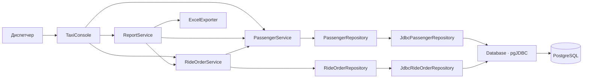
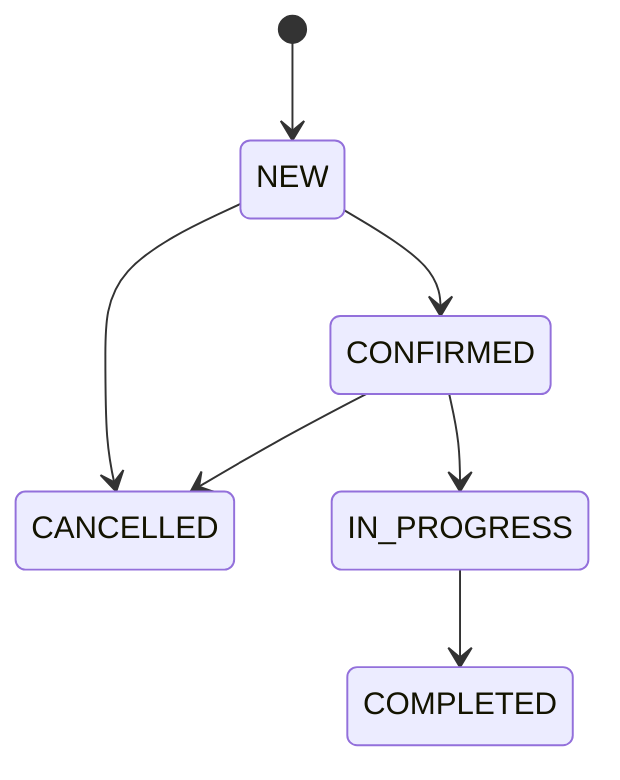

# Разбор системы для защиты

В консоли работает диспетчер. Пассажир — человек, для которого оформлена поездка. Связь один-ко-многим позволяет хранить несколько заказов одного пассажира. В БД имя и телефон записываются один раз. Экран заказа получает имя через связь и показывает актуальные данные пассажира.

## Как слои работают вместе



| Слой | За что отвечает | Что передает |
| --- | --- | --- |
| `Main` | Создаёт объекты, связывает зависимости и запускает приложение | Репозитории в сервисы, сервисы в консоль |
| `ui` | Циклы меню, ввод, отображение, сообщения об ошибках | ID, `LocalDateTime`, `BigDecimal`, `RideRequest`, `RideStatus` |
| `service` | Правила и сценарии предметной области, отчёты | Запросы к репозиториям, модели и результаты для UI |
| `repository` | SQL, параметры, преобразование строк PostgreSQL в объекты Java | `List`, `Optional`, ID вставки, успешность обновления |
| `model` | Данные объектов и допустимые статусы | `Passenger`, `RideOrder`, `RideRequest`, `RideStatus`, `TaxiStatistics` |
| `util` | Сборка файла XLSX | Путь готового файла |

### Создание заказа по шагам

1. Диспетчер выбирает главное меню `2`, затем `3`. `TaxiConsole.createRide()` получает список пассажиров через `PassengerService`. Пусть диспетчер выбирает ID `1`.
2. `ConsoleInput` читает и преобразует значения. Например, `2026-11-28 15:30` становится `LocalDateTime`, `690,50` — `BigDecimal("690.50")`. Адреса и остальные значения формируют `RideRequest`.
3. `RideOrderService.createRide()` вызывает `validateDetails()`. Сервис очищает пробелы на краях адресов, проверяет поля и через `PassengerService.getPassenger(1)` проверяет существование пассажира.
4. `JdbcRideOrderRepository.insert()` берёт `Connection` из `Database`. В SQL `INSERT INTO ride_orders ... VALUES (?, ?, ?, ?, ?) RETURNING id` устанавливаются параметры в порядке полей. Адрес с апострофом передаётся тем же способом, как любой другой адрес.
5. PostgreSQL проверяет `FOREIGN KEY` и `CHECK`, назначает ID, начальный статус `NEW` и версию `0`. `ResultSet` получает ID, например `11`, после чего JDBC-ресурсы закрываются.
6. Сервис возвращает ID. Консоль печатает `Создан заказ #11 со статусом «Новый».` и снова показывает подменю заказов.

### Получение и изменение заказа

`TaxiConsole → RideOrderService.getRide(11) → JdbcRideOrderRepository.findById(11)`. SQL использует `WHERE r.id = ?` и `JOIN passengers p ON p.id = r.passenger_id`. Репозиторий читает строку `ResultSet`, создаёт `Passenger`, затем `RideOrder`. При отсутствии строки репозиторий возвращает `Optional.empty()`, сервис выбрасывает `EntityNotFoundException`, консоль показывает ошибку и продолжает работу.

Для редактирования консоль сохраняет прочитанную версию заказа и отправляет изменённые поля с этой версией. После проверки состояния сервис вызывает запрос с условием `WHERE id = ? AND version = ?`. PostgreSQL записывает данные и увеличивает версию в той же SQL-команде. Если два диспетчера открыли версию `0`, первый записывает `1`. Сохранение формы второго получает отказ из-за устаревшей версии. Это касается изменения маршрута, смены статуса и удаления. Сервис повторно проверяет текущую версию, а запрос страхует промежуток между проверкой и записью.

### Поиск, отчёт и экспорт

- Когда ищем `КИЕВСКИЙ`, из PostgreSQL приходят заказы с пассажирами. `RideOrderService.searchByAddress()` приводит запрос и оба адреса к нижнему регистру через `Locale.ROOT`. `filter` оставляет строки, где совпал адрес подачи или назначения. На тестовой базе это № 2 и № 8.
- Когда фильтруем по дате `2026-11-25`, `LocalDateTime.toLocalDate()` выделяет календарную дату подачи. Сравнения включают обе границы, поэтому остаются № 5, № 6 и № 7.
- Для сортировки по стоимости `Comparator.comparing(RideOrder::fare)` сравнивает `BigDecimal`. При равной стоимости второй критерий — ID по возрастанию. При сортировке по времени сначала идут поздние даты, при равном времени применяется тот же критерий ID.
- `ReportService.getStatistics()` читает список заказов и за один проход подсчитывает их по статусам через `EnumMap.merge`. Например, завершённые заказы № 1, № 2 и № 4 дают 480 + 650 + 720 = 1850 ₽. Также сервис выводит число пассажиров отдельным чтением. Каждый вызов статистики заново получает данные из PostgreSQL.
- При экспорте `ReportService.exportRides()` берёт актуальный список заказов из базы. `ExcelExporter` пишет его через Apache POI. Идентификаторы текстовые для сохранения всех цифр `bigint`, даты и стоимость — числовые ячейки с форматами Excel. Файл сначала записывается во временный путь и после успешной записи переносится в выбранное место. Заголовок закреплён, по столбцам можно фильтровать.

## Участник 1. Сергеев Алексей Сергеевич

**Область:** архитектура, модель и операции с заказом. Откройте [Main.java](../src/main/java/ru/mirea/taxi/Main.java), [RideOrderService.java](../src/main/java/ru/mirea/taxi/service/RideOrderService.java) и [RideStatus.java](../src/main/java/ru/mirea/taxi/model/RideStatus.java).

На защите проследите маршрут создания заказа из примера выше. Покажите, где данные превращаются из текста в значения Java, где проверяются правила и где появляется ID. Затем объясните, что чтение, редактирование, смена статуса и удаление — разные действия, выполняемые через один сервис. Для демонстрации версии закажите поездку, откройте редактирование в двух экземплярах, сохраните форму в первом и попробуйте сохранить во втором.

| Правило | Где действует | Пример |
| --- | --- | --- |
| Пассажир должен быть в базе | Проверка в сервисе и внешний ключ | ID `999999` вызывает сообщение о том, что пассажир не найден |
| Адреса обязательны и различаются | Проверка в Java и ограничение в SQL | `ул. Лесная, 5` и `УЛ. ЛЕСНАЯ, 5` считаются одним адресом в сервисе |
| Подача в 2000–2099 годах с точностью до минуты | Проверка в Java, диапазон в SQL | `2100-01-01 12:00` выходит за диапазон |
| Стоимость положительная, до 9 999 999,99 ₽, с точностью до копеек | Java проверяет диапазон и точность, SQL хранит `numeric(9, 2)` и проверяет диапазон | `0` и `100,005` запрещены, `650,50` допустимо |
| Заказ появляется в статусе `NEW` | `CREATE` сохраняет поля поездки, PostgreSQL подставляет заданный статус | На создании меню выбора статуса отсутствует |
| Переходы имеют заданный порядок | `RideStatus.canChangeTo()`, вызов из сервиса | `NEW → COMPLETED` запрещён |
| Маршрут можно править до начала поездки | `RideOrderService.editRide()` | Изменение адреса в `IN_PROGRESS` запрещено |
| Удаляются только `NEW` и `CANCELLED` | `RideOrderService.deleteRide()` | Удаление `COMPLETED` запрещено |



**Вопросы.** Для чего enum? Он задаёт конечный набор статусов и разрешённые переходы. У каждого значения отдельная русская подпись. Для чего `record`? У модели закрытые неизменяемые поля, канонический конструктор и методы доступа. Состояние меняется через сценарий сервиса: при следующем чтении создаётся новый объект. Для чего `BigDecimal`? Он точно хранит и складывает десятичные суммы с копейками.

## Участник 2. Василевская Вероника Валерьевна

**Область:** консоль и пользовательский ввод. Откройте [TaxiConsole.java](../src/main/java/ru/mirea/taxi/ui/TaxiConsole.java), [ConsoleInput.java](../src/main/java/ru/mirea/taxi/ui/ConsoleInput.java) и [ConsoleView.java](../src/main/java/ru/mirea/taxi/ui/ConsoleView.java).

1. Покажите главное меню и подменю заказов. Метод `menu()` принимает заголовок и обработчик `MenuAction`. Внутри цикла `0` возвращает управление вызвавшему меню. Обработчик вызывает сервис, а `ConsoleView` форматирует результат.
2. Введите `abc` там, где ожидается ID. `Long.parseLong` вызывает `NumberFormatException`, `ConsoleInput` превращает её в сообщение «ID должен быть целым числом». Следом попробуйте заведомо отсутствующий ID и покажите, что сообщение теперь приходит из сервиса.
3. Покажите форму редактирования и сохранение поля через Enter. В конструктор `RideRequest` попадёт прежнее значение, видимое в квадратных скобках. Продемонстрируйте неверную дату `2026-02-30 09:00`.
4. При удалении введите `нет`. Консоль завершит действие без вызова удаления. Затем введите `да` для нового заказа и покажите исчезновение записи из списка.

**Вопросы.** Где проверяется ввод? Тип и формат — в `ConsoleInput`, предметные правила — в сервисах. Где обрабатываются ошибки? В цикле `menu()`. При закрытии потока `run()` аккуратно завершает приложение. Как подключить JavaFX? Контроллер собирает те же аргументы из полей формы, вызывает сервис и выводит результат в таблицу или диалог.

## Участник 3. Со Артем Алексеевич

**Область:** база и JDBC. Откройте [ER-диаграмму](er-diagram.svg), [SQL-схему](../sql/01-schema.sql), [Database.java](../src/main/java/ru/mirea/taxi/repository/Database.java) и [JdbcRideOrderRepository.java](../src/main/java/ru/mirea/taxi/repository/JdbcRideOrderRepository.java).

- У `passengers.id` и `ride_orders.id` свои первичные ключи. `ride_orders.passenger_id` — внешний ключ, обязательный для каждого заказа. `ON DELETE RESTRICT` защищает заказы, когда пытаемся удалить пассажира. Телефон уникальный. Статус ограничен значениями из `CHECK`.
- Для демонстрации откройте пункт 7, затем попробуйте удалить пассажира № 1 через `1 → 5 → 1 → да`. PostgreSQL вернёт SQLSTATE `23503`. `JdbcPassengerRepository` переведёт его в сообщение о связанных заказах. Попытка повторно добавить номер `+70000000001` даёт `23505`.
- В `findById` покажите открытие соединения, подготовку SQL, `statement.setLong(1, id)`, `executeQuery()` и чтение `ResultSet`. В конце вложенного блока закрывается набор результатов, затем statement и connection. `executeUpdate()` используется при изменении и удалении и возвращает число затронутых строк. Вставка с PostgreSQL `RETURNING id` возвращает набор результатов.
- `PassengerService` хранит ссылку типа `PassengerRepository`. В `Main` ей передаётся `JdbcPassengerRepository`. При вызове `findById` Java выбирает реализацию объекта во время выполнения. Это пример полиморфизма, позволяющий подставить другую реализацию репозитория при том же контракте.

**Вопросы.** Чем отличаются `Statement` и `PreparedStatement`? Первый получает SQL как готовую строку при выполнении. Второй задаёт шаблон с параметрами `?`, значения передаются отдельно, сохраняют свой тип и остаются данными. Что защищает запись от ситуации, когда пассажир исчез после проверки в Java? Конечную целостность обеспечивает внешний ключ. Что означает `version`? Номер версии записи, который позволяет обнаружить устаревшую форму.

Запрос для демонстрации связи и текущих данных в `psql`:

```sql
SELECT r.id, p.full_name, r.pickup_at, r.fare, r.status, r.version
FROM ride_orders r
JOIN passengers p ON p.id = r.passenger_id
ORDER BY r.id;
```

## Участник 4. Дадаев

**Область:** выборки и отчетность. Откройте [RideOrderService.java](../src/main/java/ru/mirea/taxi/service/RideOrderService.java), [ReportService.java](../src/main/java/ru/mirea/taxi/service/ReportService.java) и [ExcelExporter.java](../src/main/java/ru/mirea/taxi/util/ExcelExporter.java).

1. Проведите оба поиска и оба фильтра из [быстрой проверки](../README.md#быстрая-проверка). Объясните, что репозиторий собирает строки в `ArrayList`, сервис берёт его через интерфейс `List` и строит новый результат с помощью `stream()`, `filter()` и `toList()`.
2. Покажите обе сортировки и скажите, зачем добавлен порядок по ID при равном значении. Сопоставьте первый заказ после сортировки по времени и по стоимости.
3. Выведите статистику и объясните связь между строками базы, счётчиками по статусам и суммой. После завершения заказа № 11 с ценой 710,50 ₽ в сквозном примере строка «Завершён» вырастет с 3 до 4, итоговая сумма — с 1850 до 2560,50 ₽.
4. Повторите экспорт, откройте файл и сравните его строки с результатом SQL и меню. Покажите, что столбец даты поддерживает сортировку по дате, а столбец стоимости можно суммировать как числа.

**Вопросы.** Почему выборки выполняются в Java? На небольшом учебном наборе это позволяет показать Collections Framework и Stream API непосредственно. При росте объёма фильтр, сортировку и пагинацию можно перенести в репозиторий, сохранив сигнатуры сервисных сценариев. Почему набор в отчёте меняется? Экспорт заново читает заказы из PostgreSQL. Почему статистика использует `EnumMap`? Ключи — значения `RideStatus`, и один счётчик соответствует одному статусу.
