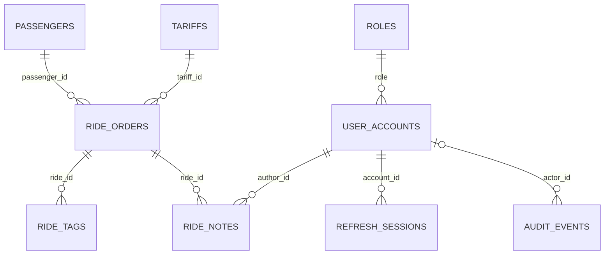

# Отчёт по КР № 3. REST-сервер и веб-интерфейс

**Дисциплина:** «Программирование корпоративных систем». **Вариант 34:** «Служба такси». **Группа:** ЭФБО-09-24.

[Условие КР № 3 в Moodle](https://online-edu.mirea.ru/mod/assign/view.php?id=942907) · [API и примеры запросов](docs/API.md) · [Общая архитектура](../docs/ARCHITECTURE.md)

## Цель и результат

Дополнить исходную диспетчерскую сетевым приложением с ролями, аудитом и собственным веб-интерфейсом. Spring Boot принимает запросы браузера и Android, управляет сессиями и обращается к PostgreSQL через Spring Data JPA. Консоль и JavaFX продолжают подключаться к PostgreSQL напрямую. Для фронтенда использованы HTML, CSS и JavaScript-модули, которые обслуживает тот же сервер.

## Запуск и исполнение

Из корня репозитория:

```powershell
.\scripts\Initialize-Local.ps1
docker compose up -d --build --wait
docker compose ps
Invoke-RestMethod http://127.0.0.1:8081/actuator/health
```

Веб открывается по адресу [127.0.0.1:8081](http://127.0.0.1:8081/), [Swagger UI](http://127.0.0.1:8081/swagger-ui.html) показывает методы API, [OpenAPI JSON](http://127.0.0.1:8081/v3/api-docs) содержит их формальное описание. Временный логин и пароль администратора берутся из `.env`. Введите их и установите собственный новый пароль при первой авторизации. Для сравнения ролей через «Пользователи» создайте наблюдателя и диспетчера с временными паролями.

В режиме отладки можно запустить PostgreSQL в Docker, собрать JAR и поднять Spring Boot локально:

```powershell
docker compose up -d --wait postgres
docker compose stop backend
.\scripts\Use-TaxiEnvironment.ps1
mvn -pl kr-03 -am package
java -jar kr-03/target/taxi-backend-1.0.0.jar
```

## Реализация

| Слой | Основные элементы | За что отвечает |
| --- | --- | --- |
| Контроллер | `RideController`, `AuthController`, `DirectoryController`, `DashboardController` | HTTP-ресурсы, DTO, HTTP-коды, проверка доступа на запись |
| Сервисы | `RideService`, `CsvRideService`, `BulkRideService`, `AuthService`, `AuditService` | Бизнес-правила, чтение и запись внутри транзакций, выдача токенов |
| Доступ к БД | `RideRepository`, `TariffRepository`, `UserAccountRepository` и другие Spring Data-интерфейсы | Запросы, выбор страницы, блокировка refresh-сессии |
| Предметная модель | `Ride`, `PassengerRow`, `Tariff`, `RideNote`, `UserAccount` | Отображение таблиц PostgreSQL, связи между объектами, версионность |
| Фильтры | `RideFilter`, `QueryFilters`, `CorrelationFilter` | Criteria-предикаты, список разрешённых полей сортировки, ID запроса |
| Безопасность | `SecurityConfig`, `JwtTokens`, `LoginAttempts`, `PasswordPolicy` | Spring Security, подпись JWT, BCrypt, роли, ограничение попыток |
| Веб | [app.js](src/main/resources/static/app.js) и [модули UI](src/main/resources/static/ui) | Авторизация, таблицы и формы, два шага импорта, маршруты по разделам |

### База и миграции

`V1__console_schema.sql` фиксирует исходную схему и демонстрационные данные КР 1. На базе, где таблицы уже есть, Flyway ставит метку версии 1. `V2__server_capabilities.sql` добавляет поля и таблицы. Hibernate проверяет соответствие структуры с `ddl-auto: validate`. Основные связи:

- `ride_orders.passenger_id → passengers.id` и `ride_orders.tariff_id → tariffs.id`.
- `ride_tags.ride_id` и `ride_notes.ride_id` ссылаются на внутренний ключ заказа. Автор заметки ссылается на `user_accounts`.
- `user_accounts.role → roles.code`. `refresh_sessions.account_id` связывает сессию с пользователем.
- `audit_events` хранит автора, категорию события, тип и UUID сущности, время, описание и `correlation_id`.

`archived` отделяет скрытые заказы от активных. Архивирование и восстановление — обновления поля и версии. Физическое удаление выполняется только администратором из архива. На уровне БД связанные теги и заметки удаляются каскадно. Для оператора `version` — номер сохраненной редакции, для Hibernate — поле `@Version`.



### Приоритет, фильтры и массовые операции

Приоритет `HIGH` назначается заказу с детским креслом или стоимостью от 1200 ₽. Обычный `NORMAL` начинается с 750 ₽. Остальные заказы получают `LOW`. `Priority.calculate` рассчитывает показатель для карточек и аналитики, а эквивалентные предикаты в `RideFilter` фильтруют записи на сервере.

В поиске адрес, имя пассажира и внешний код сравниваются без учёта регистра. На странице можно совместить тариф, статус, детское кресло, приоритет, тег, архив и сравнение стоимости. Criteria API принимает значения как параметры. Символы `%` и `_` из строки поиска экранируются и ищутся буквально. Поля сортировки ограничены списком из времени подачи, суммы, кода и времени изменения. Размер страницы — от 1 до 100, нумерация начинается с нуля.

Массовая операция выполняет отдельную транзакцию на заказ. Если из двух UUID один отсутствует, второй может измениться успешно. Ответ содержит успешные UUID и причины отказов.

### Как работает сессия

1. `POST /api/auth/login` получает логин, пароль и тип клиента. BCrypt проверяет пароль. Для пары «адрес запроса и логин» действует окно ограничения попыток.
2. Сервер выдаёт access JWT на 15 минут и отдельный случайный refresh-токен. В PostgreSQL сохраняется SHA-256 строки токена, срок, клиент и версия учётной записи.
3. Браузер получает refresh-токен в cookie с `HttpOnly` и `SameSite=Strict`, Android получает его в JSON. Клиенты отправляют access JWT в заголовке Bearer. JWT привязан к версии активной учётной записи.
4. После `401` клиент запрашивает refresh. Транзакция блокирует найденную серверную сессию, отзывает прежний refresh-токен и создаёт новую пару. Исходный запрос повторяется один раз.
5. При выходе сервер отзывает refresh-сессию. Смена пароля и изменение роли отзывают старые учётные данные. Для временного пароля API разрешает просмотр профиля и его смену, доступ к заказам открывается после смены.

| Роль | Возможности |
| --- | --- |
| VIEWER | Просмотр заказов, справочника, заметок, аналитики и экспорт |
| DISPATCHER | Всё чтение плюс создание, изменение, архив, восстановление, импорт, массовые действия и свои заметки |
| ADMIN | Дополнительно справочник на запись, учётные записи, аудит, любые заметки и окончательное удаление архивного заказа |

### Заметки, CSV и аналитика

Заметка имеет автора, время создания и редактирования, текст и признак закрепления. Изменить или удалить её может автор с правом записи либо администратор.

У CSV отдельные методы проверки и применения. Preview валидирует UTF-8, заголовки, строки, связи, правила и дубликаты без записи. Apply повторяет проверку и применяет весь файл одной транзакцией. Режим NEW_ONLY разрешает новые коды, UPSERT обновляет активный заказ по внешнему коду или добавляет новый. Входной файл ограничен 512 КБ и 1000 строками. При экспорте текущий фильтр применяется ко всем подходящим строкам без ограничения страницы. [Пример CSV](examples/ride-import.csv) готов к импорту в чистую учебную базу.

Сводка показывает общее число заказов, активные, архивные, количество заказов с креслом, среднюю сумму и группировки по тарифу, статусу и приоритету. Термин «активный» означает, что заказ находится вне архива. Статус поездки описывается отдельным полем.

## Проверка и показ на защите

- `mvn verify` из корня запускает шесть тестов backend. Проверяются запуск Spring Context, пороги приоритета, параметры поиска и страницы, сложность пароля и ограничение попыток.
- Корневая Docker-сборка поднимает два healthy-сервиса. В проверке существующей базы Flyway зарегистрировал baseline 1 и миграцию 2, на пустой тестовой базе — обе миграции.
- [Скрипт проверки REST](scripts/verify-api.mjs) выполняет вход со сменой временного пароля, проверку ролей, CRUD, конфликт версии, фильтры, заметки, пакетные операции, импорт, экспорт, аудит и отзыв сессии. Он рассчитан на отдельную чистую базу. [Команды повтора](docs/API.md#автоматическая-проверка).
- В браузере проверялись вход, загрузка списка, аналитика, обновление страницы с восстановлением сессии и выход.
- На базе после Flyway заказ, созданный в консоли через JDBC, появился в REST под кодом `TX-<id>`. После архивации через REST этот ID перестал находиться в консоли.

**Сергеев Алексей Сергеевич** показывает обработку запроса, бизнес-правила и версии. **Василевская Вероника Валерьевна** показывает веб-интерфейс, роли и форму заказа. **Со Артем Алексеевич** показывает две миграции, JPA-связи и проверку схемы. **Дадаев** показывает фильтры, CSV, аналитику и этапы проверки.
